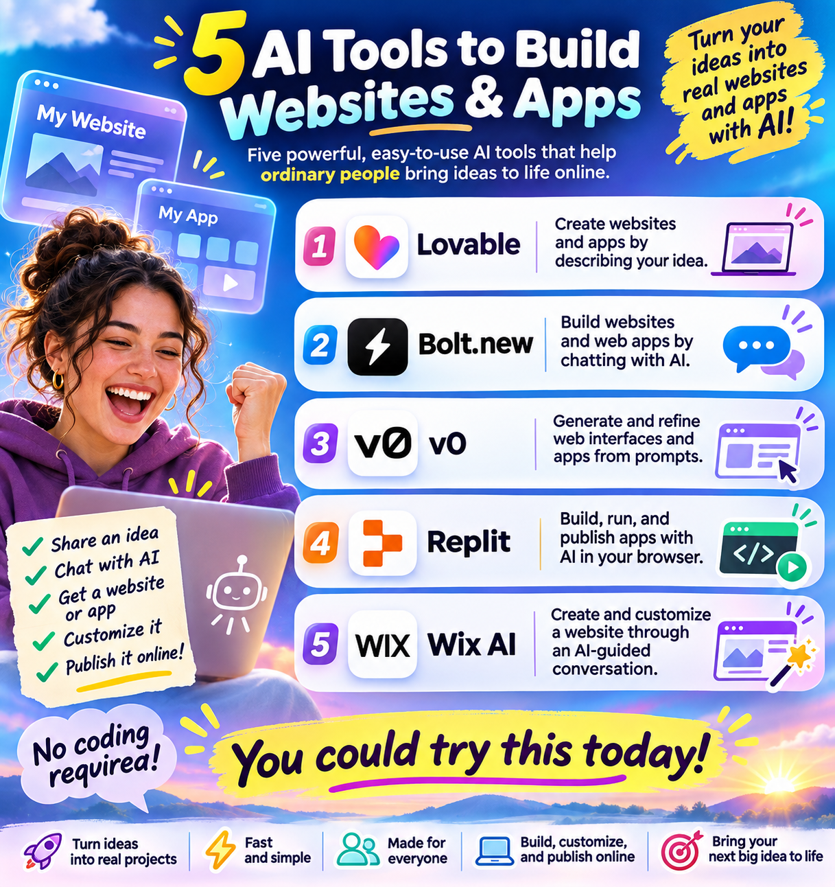
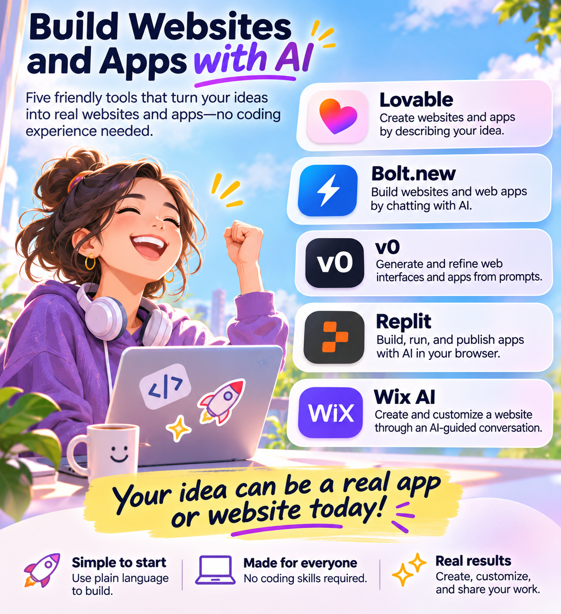
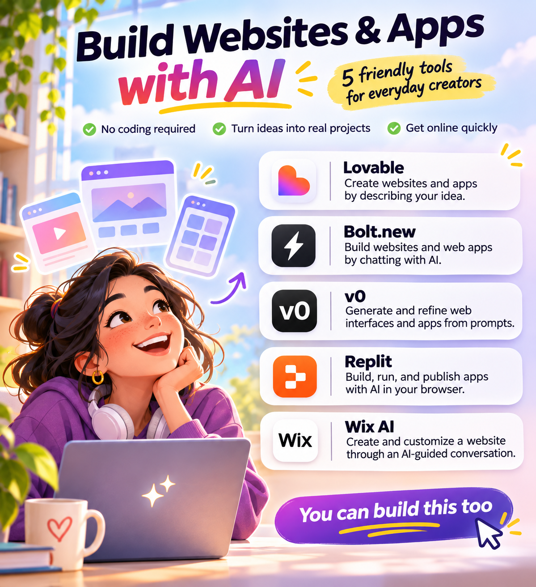

# Five AI tools infographic

One shared brief, five recorded outputs. Created on 2 November 2026.

The tools, their order, and their descriptions are fixed. The images below are the original outputs, without manual retouching or aesthetic rerolls. Click an image to open the full-size file.

## Shared prompt

```text
Create a finished educational social-media infographic about five AI tools that help ordinary people build websites and applications.

Use exactly these five tools, in this order, with the following names and descriptions unchanged; you may choose the layout and line breaks:
1. Lovable — Create websites and apps by describing your idea.
2. Bolt.new — Build websites and web apps by chatting with AI.
3. v0 — Generate and refine web interfaces and apps from prompts.
4. Replit — Build, run, and publish apps with AI in your browser.
5. Wix AI — Create and customize a website through an AI-guided conversation.

Your mission is to replace hesitation with excitement, confusion with clarity, and “I could never do that” with “I could try this today.”
The overall emotional experience should be optimistic, empowering, energetic, friendly, practical, reassuring, immediately understandable, and full of possibility. Make advanced technology feel approachable and useful.
Take full creative responsibility for translating these communication goals into the finished image.
```

## Results

| Off | Lite |
| --- | --- |
| [](images/off.png) | [](images/lite.png) |

| Full | Ultra |
| --- | --- |
| [](images/full.png) | [](images/ultra.png) |

### Ultra ×2

The first Ultra image was supplied as the only image reference for a second edit pass. The same Air Ultra instructions and original brief were retained. The revision request was:

> Make the supplied infographic more aligned with Air Ultra, while fulfilling the original brief and preserving the five fixed tool names, descriptions, and order.

[](images/ultra-x2.png)

Ultra ×2 is a second pass, not another strength setting.

## Exact inputs

| Condition | Image-tool input | Image reference |
| --- | --- | --- |
| Off | [Prompt](inputs/off.txt) | None |
| Lite | [Prompt](inputs/lite.txt) | None |
| Full | [Prompt](inputs/full.txt) | None |
| Ultra | [Prompt](inputs/ultra.txt) | None |
| Ultra ×2 | [Edit prompt](inputs/ultra-x2.txt) | [Original Ultra image](images/ultra.png) |

The [skill snapshot](air-skill.txt) is the exact version used for this example. [The record](record.json) contains input and image hashes, dimensions, and the Ultra ×2 image lineage.

## How this was run

Each image request was relayed unchanged through a separate fresh courier context. The couriers did not rewrite the art direction or inspect the other outputs. Off received only the shared brief; Lite, Full, and Ultra also received the complete Air skill and their selected mode. No previous images were requested for those first four conditions.

The native image-generation tool does not expose its exact model revision, random seed, or hidden service context. General platform and tool instructions still apply, so complete backend isolation is unverified.

This is one recorded comparison, not an aggregate benchmark or a guarantee that stronger Air settings produce better results. Tool descriptions are supplied example content; capabilities and branding may change over time.

[Back to all examples](../../README.md#examples)
